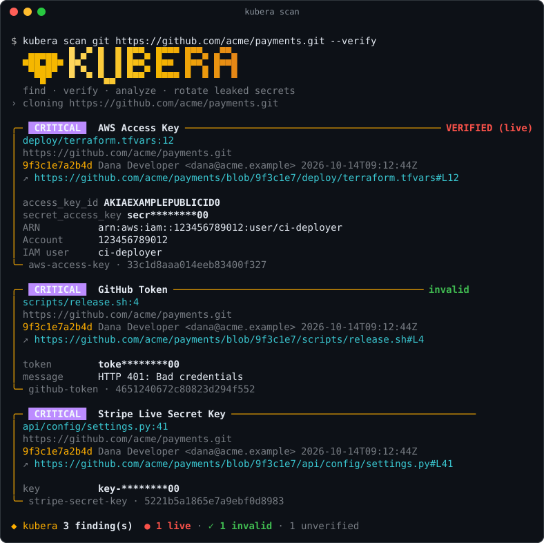
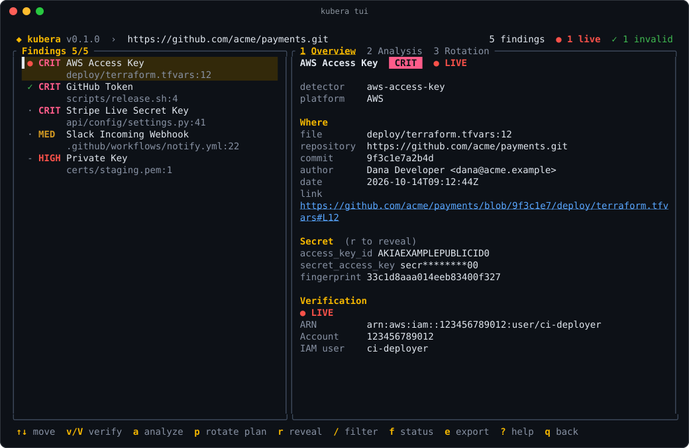
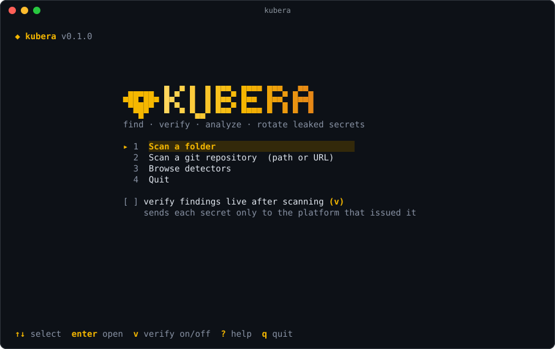
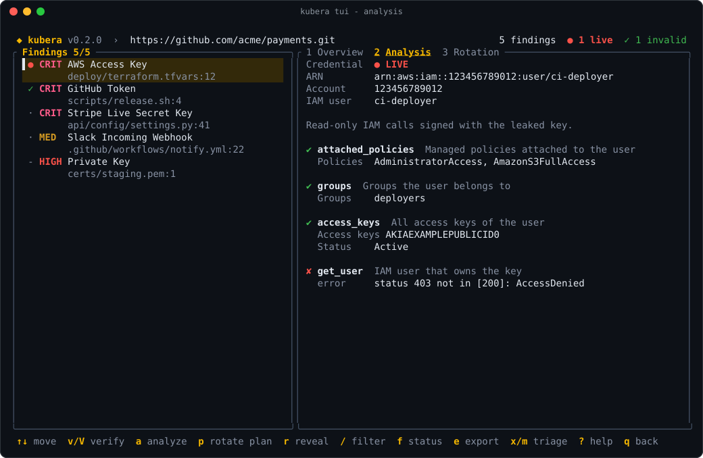
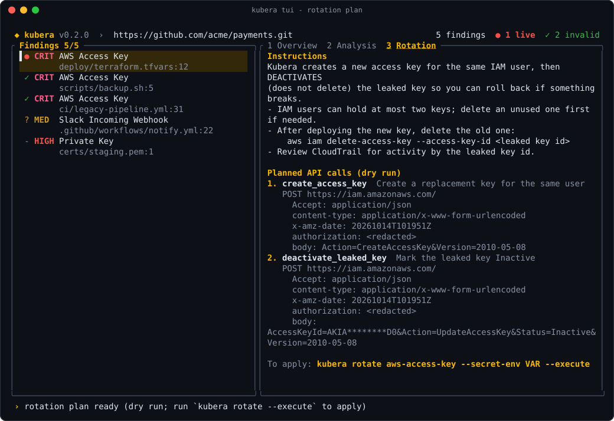
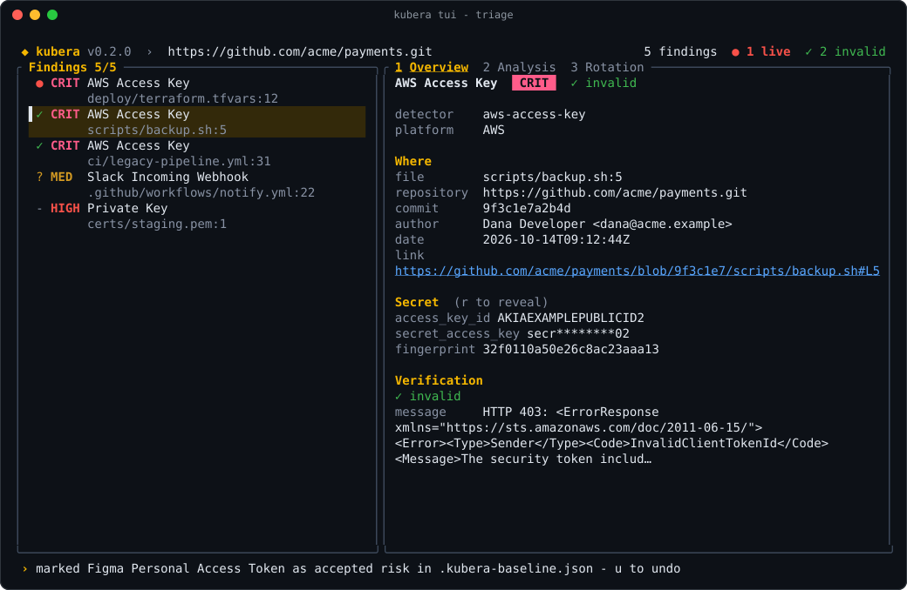
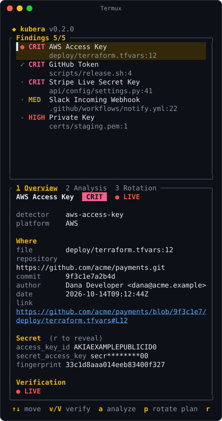
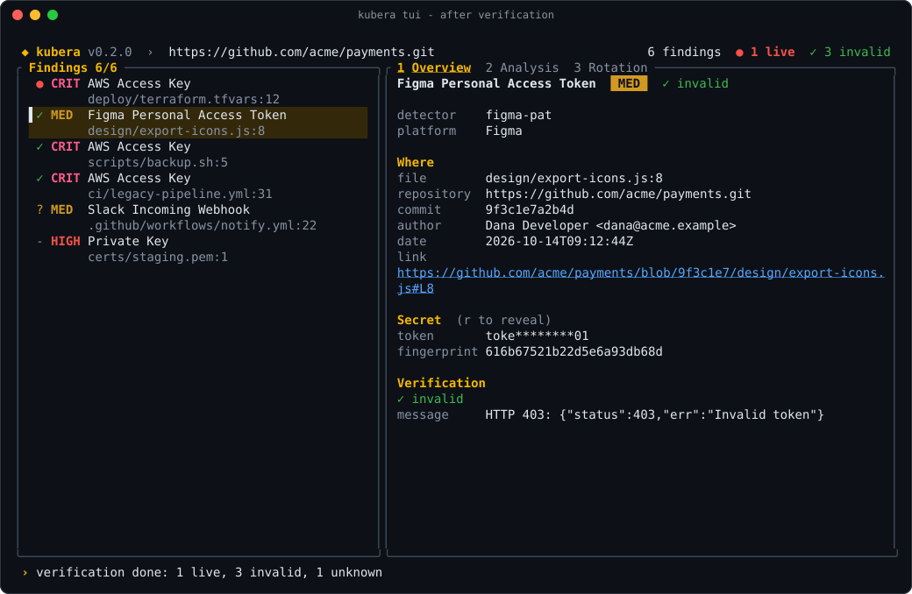

<p align="center">
  
</p>

<p align="center">
  <a href="https://github.com/dmdhrumilmistry/kubera/actions/workflows/ci.yml"></a>
  <a href="https://crates.io/crates/kubera-cli"></a>
  <a href="https://dmdhrumilmistry.github.io/kubera/"></a>
  
  
  <a href="LICENSE"></a>
</p>

<p align="center">
  <b>Kubera</b> is a fast, template-driven secret scanner written in Rust.<br>
  It finds leaked credentials in code, git history, whole GitHub/GitLab/Bitbucket orgs, container images,<br>
  GitHub issues and Actions logs, S3/GCS buckets and live Kubernetes clusters,<br>
  checks whether they are <b>live</b>, shows what they can <b>access</b>, and <b>rotates or revokes</b> them.<br>
  89 detectors; adding a platform takes one YAML file, not new code.
</p>

<p align="center">
  <code>curl -fsSL https://raw.githubusercontent.com/dmdhrumilmistry/kubera/main/install.sh | sh</code>
</p>

<p align="center">
  <a href="#install">Install</a> ·
  <a href="#quick-start">Quick start</a> ·
  <a href="#interactive-tui">TUI</a> ·
  <a href="#after-a-scan">After a scan</a> ·
  <a href="#scanning-remote-repositories">Remote repos</a> ·
  <a href="#ci-and-pre-commit">CI</a> ·
  <a href="#builtin-detectors">Detectors</a> ·
  <a href="#adding-a-platform">Templates</a> ·
  <a href="https://dmdhrumilmistry.github.io/kubera/">Docs</a>
</p>

<p align="center">
  
</p>

## Features

|  |  |
|---|---|
| 🔍 **Detect** | Files, full git history (local, HTTPS, SSH or `github.com/org/repo`), **container images** and stdin, including secrets committed and later deleted, or deleted in a later image layer. Opens **archives** (jar, zip, whl, tar.gz, nested) and **decodes** base64, URL-encoded and escaped values. 89 detectors. |
| 🌐 **Beyond code** | **GitHub** issues, PRs, review comments, **Actions logs**, wikis and gists; **S3 / GCS buckets** (and MinIO, R2); **live Kubernetes** Secrets, ConfigMaps and workload env. [GitHub →](https://dmdhrumilmistry.github.io/kubera/github.html) · [Buckets →](https://dmdhrumilmistry.github.io/kubera/buckets.html) · [Kubernetes →](https://dmdhrumilmistry.github.io/kubera/kubernetes.html) |
| 🏢 **At scale** | Scan whole **GitHub / GitLab / Bitbucket orgs** with rate-limit handling and cached mirrors; **incremental** runs only read commits added since the last passing scan (47× faster re-scans); **resumable** long scans with `--checkpoint`. |
| ✅ **Verify** | Asks each platform whether the secret is live, concurrently and de-duplicated. |
| 🧭 **Analyze** | Owner, scopes, reachable resources and permission probes. |
| 🔁 **Rotate** | Dry-run plan by default; vendor API calls only with `--execute` and confirmation. Manual runbooks for platforms with no API. |
| 🔐 **Close the loop** | `rotate --store` writes the new credential to **GitHub Actions secrets** (sealed-box encrypted locally), **Vault** KV v2 or **AWS Secrets Manager**, checked before anything rotates and never lost if a store fails. [Details →](https://dmdhrumilmistry.github.io/kubera/secret-stores.html) |
| 🖥️ **Interactive** | A keyboard-driven TUI, hidden secret prompts, and auto-identification of pasted secrets. |
| 🧹 **Remediate** | `kubera remediate` opens **one GitHub issue per live secret** (deduplicated by fingerprint, optional committer mention, private repositories only); `kubera purge` prepares a **git filter-repo** history rewrite of the leaked values and prints the commands. [Details →](https://dmdhrumilmistry.github.io/kubera/remediation.html) |
| 🗂️ **Triage** | A committed **baseline** so CI only fails on new leaks; mark false positives (`x`) or accepted risks (`m`) in the TUI. [Details →](https://dmdhrumilmistry.github.io/kubera/triage.html) |
| 🛡️ **Prevent** | A **pre-commit hook** (`kubera hook install`, or the pre-commit framework), a **GitHub Action** with code scanning, and a **Docker image**. [CI →](https://dmdhrumilmistry.github.io/kubera/ci.html) |
| 🧩 **Templates** | Everything per-platform lives in validated YAML, with built-in test samples. |
| 📤 **Outputs** | Pretty cards, JSON, JSONL, SARIF 2.1.0 and a self-contained **HTML report**, with links to the exact line on GitHub, GitLab and Bitbucket. Secrets redacted by default. |
| 📈 **Dashboard** | `scan --db` records every scan (redacted) in a local findings database; `kubera serve` shows trends, open live findings, per-repository and per-detector breakdowns and first / last seen, plus a JSON API. Localhost only by default. [Details →](https://dmdhrumilmistry.github.io/kubera/dashboard.html) |
| 🔔 **Alerts** | **Slack** and HMAC-signed **webhooks** when a scheduled scan finds live secrets. [Details →](https://dmdhrumilmistry.github.io/kubera/alerts.html) |
| 🤖 **MCP server** | `kubera mcp` lets AI assistants scan and verify, while secrets never reach the model. |
| ⚡ **Fast** | ~660 MB/s on 4 vCPUs (335 MB of real code in 0.51 s, decoders on); one `git log` per CPU scans all 24,445 commits of rust-lang/cargo in 3.7 s (10.6 s single-process). [Benchmarks →](https://dmdhrumilmistry.github.io/kubera/benchmarks.html) |
| 📱 **Everywhere** | Linux, macOS, Windows and Android (Termux), with layouts that adapt to phone screens. |

## Install

```bash
curl -fsSL https://raw.githubusercontent.com/dmdhrumilmistry/kubera/main/install.sh | sh   # Linux, macOS, Termux
cargo install kubera-cli --locked                                                        # any platform with Rust 1.88+
nix run github:dmdhrumilmistry/kubera -- --version                                       # Nix flake (builds from source)
docker run --rm -v "$PWD:/scan" ghcr.io/dmdhrumilmistry/kubera scan git /scan              # container image
```

```powershell
irm https://raw.githubusercontent.com/dmdhrumilmistry/kubera/main/install.ps1 | iex       # Windows (x86_64, ARM64)
```

Homebrew, Scoop, winget and AUR packages are on the way ([status](https://dmdhrumilmistry.github.io/kubera/installation.html#package-managers)). Installed with a script or from a release archive? `kubera update` fetches the latest release, verifies it and swaps it in atomically (only when you run it; no background checks).

The installers download the release binary for your platform, **verify its SHA-256**, and install `kubera` to `~/.local/bin` (or `$PREFIX/bin` on Termux; `%LOCALAPPDATA%\Programs\kubera\bin` on Windows, added to your user PATH). Prebuilt archives for Linux, macOS, Windows and Android are on the [releases page](https://github.com/dmdhrumilmistry/kubera/releases). Release files come with SHA-256 checksums, Sigstore signatures and an SBOM, and releases after v0.2.0 also carry GitHub build provenance ([verifying](https://dmdhrumilmistry.github.io/kubera/installation.html#verifying-a-release)). The crate is `kubera-cli`; the command is `kubera`. The image (`ghcr.io/dmdhrumilmistry/kubera`, linux/amd64 and arm64) runs as non-root and includes git. [Installation →](https://dmdhrumilmistry.github.io/kubera/installation.html)

## Quick start

```bash
kubera                                   # interactive TUI
kubera scan fs .                         # scan a directory
kubera scan git . --verify               # whole history, verify what's found
kubera scan git github.com/org/repo -i   # a remote repo, results in the TUI
kubera scan image ghcr.io/org/app:1.4     # every layer + ENV/history, no Docker needed
kubera scan repos --github-org acme --token-env GH_TOKEN --cache-dir ~/.cache/kubera --state state.json
kubera scan git . --state .kubera-state.json --fail   # CI: only new commits
kubera scan fs . --fail -f sarif > kubera.sarif     # CI: SARIF + exit code 183
kubera scan git . --verify -f html > report.html    # self-contained HTML report
kubera scan github --org acme --token-env GH_TOKEN   # issues, PRs, Actions logs, wikis
kubera scan bucket s3://acme-backups --verify        # S3 / GCS, archives opened
kubera scan k8s --verify                             # live cluster: Secrets, ConfigMaps, env
kubera hook install                                  # block commits that add secrets
kubera scan git . --update-baseline                  # accept today's findings; fail only on new ones
kubera scan git . --verify --db && kubera serve      # record scans, open the local dashboard
```

Check a single credential. Paste it at a hidden prompt, and Kubera works out what it is:

```bash
kubera verify                            # "Paste the secret (hidden):" → identified, verified
kubera analyze gitlab-pat --secret-env TOKEN
kubera rotate  gitlab-pat --secret-env TOKEN                        # dry run: shows the plan
kubera rotate  gitlab-pat --secret-env TOKEN --execute -o new.json  # rotate, new token saved 0600
kubera rotate  gitlab-pat --secret-env TOKEN --execute --store github:acme/api:GITLAB_TOKEN --store-token-env GH_TOKEN  # straight into an Actions secret
```

## Interactive TUI

Run `kubera` with no arguments to scan, browse findings, verify (`v`), analyze (`a`) and plan rotations (`p`), all from the keyboard. Mark false positives (`x`) or accepted risks (`m`) as you go. Secrets stay masked until you press `r`. What to do next: [After a scan](#after-a-scan).

<p align="center">
  
</p>

<details>
<summary>More screenshots: home screen, analysis tab, rotation plan, triage, phone layout</summary>
<p align="center">
  <br><br>
  <br><br>
  <br><br>
  <br><br>
  
</p>
</details>

## After a scan

Verification sorts findings by what the platform says, and each status has a clear next step:

| Status | Meaning | Next step |
|---|---|---|
| `●` live | The credential works | Analyze (`a`), plan the rotation (`p`), then `kubera rotate <detector> --execute -o new.json`, update consumers and verify again |
| `✓` invalid | Revoked, expired or fake | Nothing to rotate: mark it accepted (`m`) or false positive (`x`) and commit `.kubera-baseline.json` |
| `?` unknown | Network error, rate limit, odd response | Verify again later (`v`), or check in the vendor console |
| `-` not verifiable | No verifier (private keys) | Review by hand |

<p align="center">
  
</p>

The full guide, with the rotation and history clean-up steps: [After a scan: triage and response](https://dmdhrumilmistry.github.io/kubera/workflow.html) · [Cheat sheet](https://dmdhrumilmistry.github.io/kubera/cheatsheet.html)

## Scanning remote repositories

```bash
kubera scan git https://github.com/org/repo.git       # HTTPS
kubera scan git git@github.com:org/repo.git           # SSH (your keys / agent)
kubera scan git github.com/org/repo                   # shorthand
kubera scan git https://github.com/org/private.git --token-env GH_TOKEN   # private repo
```

Repositories are cloned bare into a temp dir and deleted afterwards. Tokens reach git as an origin-scoped `Authorization` header through environment variables, never on the command line, and are never sent over plain HTTP. Findings on GitHub, GitLab and Bitbucket link to the exact line at the commit. [Details →](https://dmdhrumilmistry.github.io/kubera/remote.html)

## Builtin detectors

**89 detectors**, 81 with live verification, 25 with analysis, 11 with API rotation/revocation. Every verifier is checked against the real vendor API with fake credentials.

| Category | Detectors |
|---|---|
| Cloud & infra | AWS (SigV4, API rotation), Cloudflare (PUT roll), DigitalOcean, Heroku, Netlify, Render, Pulumi, Terraform Cloud, Infracost, Databricks, Prefect, Supabase, Neon, Tailscale, Azure storage, GCP service accounts, Google API keys, Vault, database URIs |
| Source control & CI | GitHub (revoke), GitLab PAT (rotate) + runner tokens, CircleCI, Buildkite (revoke) |
| Package registries | npm, PyPI, RubyGems, Docker Hub |
| Payments & commerce | Stripe, Square, PayPal, Razorpay, Shopify, Shippo, EasyPost, Duffel |
| Communication | Slack token (revoke) + webhook, Discord bot + webhook (DELETE), Telegram, Twilio (API rotation), Intercom |
| Email | SendGrid (API rotation), Mailgun, Mailchimp, Postmark, Brevo, Resend |
| AI | OpenAI, Anthropic, Hugging Face, Groq, Replicate, xAI, Pinecone, OpenRouter, Perplexity, DeepSeek, Cerebras, ElevenLabs, LangSmith, Langfuse |
| Observability | Datadog (all sites), New Relic, Sentry, Grafana Cloud + service accounts |
| SaaS & productivity | Notion, Linear, Asana, ClickUp, Airtable, Figma, Contentful, Postman, Typeform, Algolia, Mapbox, Cloudinary, Dropbox, HubSpot, ReadMe, LaunchDarkly, Snyk, Doppler, Okta (revoke) |
| Keys | PEM/OpenSSH/PGP private keys, age |

Full table with endpoints: [Builtin detectors](https://dmdhrumilmistry.github.io/kubera/detectors.html), or `kubera templates list`.

## Adding a platform

```bash
kubera templates new acme-key > templates.d/acme.yaml   # skeleton with every section
kubera templates validate templates.d/                  # schema, regexes, variables, samples
kubera -t templates.d scan fs .                         # use it (same id overrides a builtin)
```

```yaml
id: acme-key
name: Acme API Key
platform: Acme
severity: high
detect:
  keywords: [acme_]
  patterns:
    - name: token
      regex: '\b(acme_[A-Za-z0-9]{32})\b'
      min_entropy: 3.5
verify:
  request:
    url: https://api.acme.dev/v1/me
    auth: { type: bearer, token: "{{ token }}" }
  valid:   { status: [200] }
  invalid: { status: [401] }
  extract:
    - { name: account, label: Account, json: user.email }
```

The [template reference](https://dmdhrumilmistry.github.io/kubera/templates.html) covers every field: auth types including AWS SigV4, matchers, extractors, rotation inputs and outputs, and samples.

## CI and pre-commit

```yaml
# .github/workflows/secrets.yml: PRs scan only their own commits, pushes only the pushed ones
permissions: { contents: read, security-events: write }
on: [push, pull_request]
jobs:
  kubera:
    runs-on: ubuntu-latest
    steps:
      - uses: actions/checkout@v4
        with: { fetch-depth: 0 }
      - uses: dmdhrumilmistry/kubera@v0.2.0   # SARIF to code scanning, job summary, annotations
```

```bash
kubera hook install          # pre-commit hook: scans only the lines a commit adds
kubera scan staged --fail    # what the hook runs
```

Also available for the [pre-commit framework](https://pre-commit.com) (`id: kubera` or `kubera-system`) and as a Docker image for any CI. Adopt Kubera on an old codebase with `--update-baseline` and commit `.kubera-baseline.json`: CI then fails only on new secrets. [CI →](https://dmdhrumilmistry.github.io/kubera/ci.html) · [Pre-commit →](https://dmdhrumilmistry.github.io/kubera/hooks.html) · [Baselines →](https://dmdhrumilmistry.github.io/kubera/triage.html)

## MCP server

```bash
claude mcp add kubera -- kubera mcp --allow-verify
```

AI assistants get `scan_path`, `scan_git`, `scan_image`, `scan_text` and fingerprint-based `verify_finding` / `analyze_finding` / `rotation_plan`. **Secrets never reach the model**: tools return redacted findings, follow-ups take fingerprints, and the model can't pass credentials. [Details →](https://dmdhrumilmistry.github.io/kubera/mcp.html)

## Configuration

`.kubera.yaml` in the working directory (or `--config`):

```yaml
templates: [./templates.d]
exclude_detectors: [google-api-key]
exclude_paths: ["**/testdata/**"]     # node_modules, vendor, lockfiles are skipped by default
allowlist:
  fingerprints: [bc0458ecc5e4611e9dde21f8]
  secrets: ['^AKIA.*EXAMPLE$']
```

Add `kubera:ignore` to a line to suppress findings on it.

## Security model

- **Opt-in network.** A plain scan of local files or history sends nothing anywhere. With `--verify`, each secret goes only to the endpoint its own template names, over HTTPS, without following redirects.
- **Redacted by default** in every output, the TUI, exports, HTML reports and alerts. Secrets, tokens and webhook URLs come in through env vars, stdin or hidden prompts rather than argv. Baselines hold fingerprints only; checkpoints, which must hold secrets, are `0600` and deleted when the scan completes.
- **Rotation is a dry run** unless `--execute`. It re-verifies first, asks for confirmation, stops at the first failure without losing a newly created key, and writes output files with mode `0600`.
- **Hostile repositories are safe to scan.** There's no external diff, textconv, hooks or fsmonitor, revisions go after `--end-of-options`, there are no credential prompts, and symlinks are never followed.

Templates are code: only load templates you trust. See the [security model](https://dmdhrumilmistry.github.io/kubera/security.html).

## Documentation

Full documentation: **https://dmdhrumilmistry.github.io/kubera/** (sources in [`docs/`](docs/)).

## License

[MIT](LICENSE)
