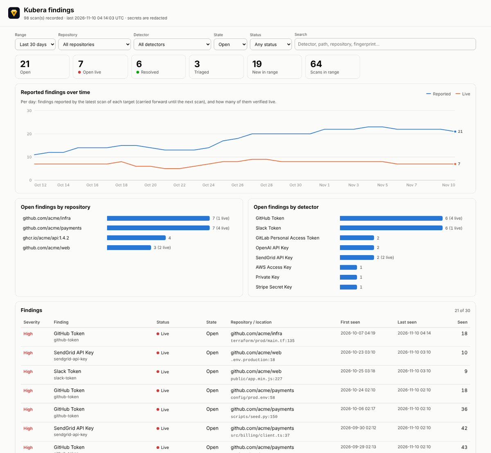
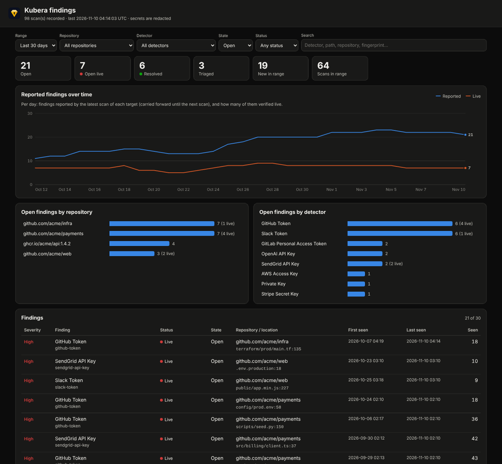

# Findings dashboard

A single scan answers "what leaked?". A history of scans answers the questions that come after: is the number of open leaks going down, which repositories keep leaking, how long has that live key been sitting there, did last week's fix stick? Kubera can record every scan in a local **findings database** and show it in a **web dashboard** on your machine.

```bash
kubera scan git . --verify --db           # record this scan
kubera serve                              # http://127.0.0.1:8484/
```



## Record scans

Add `--db` to any scan (`fs`, `git`, `repos`, `image`, `github`, `bucket`, `k8s`, ...):

```bash
kubera scan repos --github-org acme --token-env GH_TOKEN --verify --db
kubera scan image ghcr.io/acme/api:1.4.2 --verify --db
```

| Option | Meaning |
|---|---|
| `--db` | Record in the default database: `$XDG_DATA_HOME/kubera/findings.jsonl` (usually `~/.local/share/kubera/findings.jsonl`) on Linux, BSD and Termux, `~/Library/Application Support/kubera/findings.jsonl` on macOS, `%LOCALAPPDATA%\kubera\findings.jsonl` on Windows. |
| `--db=PATH` | Record in `PATH` instead. Write it with `=` (or put `--db PATH` after the scan's own paths), so the path is not mistaken for a scan target. |
| `--no-db` | Do not record, even if `.kubera.yaml` says so. |

Or turn it on for every scan of a project in `.kubera.yaml`:

```yaml
db: true                    # the default database
# db: .kubera/findings.jsonl  # or a file, relative to this config
```

Each scan appends **one line** to the file, a JSON object with the time, the target (repository URL, canonical path, image, ...), the kind of scan, whether it was partial, the counts, every finding, and the triage decisions of the baseline in effect. A recorded scan that cannot be written prints a warning and makes an otherwise clean scan exit `1`, so a scheduled job that lost its record does not look green.

<div class="kubera-callout tip">
<p class="kubera-callout-title">No secrets in the database</p>

Findings are stored **redacted**, exactly like `-f json` output: the detector, the fingerprint, the location, the verification status and a masked preview (`ghp_********Uo`). Even with `--show-secrets`, the database never receives a secret value. The file is created with mode `0600` in a `0700` directory.

</div>

## What the dashboard shows

For each secret (fingerprint) across every recorded scan:

- **first seen** and **last seen**, and **how many scans** reported it;
- its **latest verification status**: live, invalid, unknown, not verifiable or not verified;
- the **repositories** and **locations** (path, line, commit, link) it was found at;
- the **triage decision** from the baseline (false positive, accepted risk, baseline), if any;
- its **state**:

| State | Meaning |
|---|---|
| Open | Still reported by the latest scan of a target it was found in. |
| Resolved | A later **full** scan of every target it was found in no longer reports it: removed from the code (for `scan fs`), or the history was rewritten. |
| Triaged | The baseline in effect at the latest scan has a decision for it. |

Partial scans never resolve anything, since a missing finding does not mean it is gone: incremental git scans (`--state`, `--since-commit`, `--branch`, `--max-depth`), staged changes, stdin, filtered results (`--only-verified`, `--results`) and scans limited to some namespaces or kinds. Remember that a secret in git history is reported by every full history scan until the history is rewritten: mark it in the baseline once it is rotated, and it becomes **triaged**.

The page has:

- a **filter row** (time range, repository, detector, state, status and free-text search) that scopes everything below it;
- **tiles**: open, open live, resolved, triaged, new in the range, scans in the range;
- a **trend chart**: per day, the findings reported by the latest scan of each target (carried forward until that target's next scan), and how many of them verified live. Hover it, or focus it and use the arrow keys, for the values of a day;
- **breakdowns** of open findings per repository and per detector (click a bar to filter);
- the **findings table** (click a row for the fingerprint, decision, targets and every location, with links to the line);
- the **recent scans**: time, target, kind, counts, and how many findings each one saw first.

It follows the system's light or dark theme and adapts to phone screens.



## JSON API

The page reads the same API you can script against. Every endpoint is a `GET` and returns JSON.

| Endpoint | Returns |
|---|---|
| `/api/findings` | One object per secret: `fingerprint`, `detector`, `name`, `severity`, `status`, `state`, `decision`, `first_seen`, `last_seen`, `times_seen`, `preview`, `targets`, `repositories`, `locations`. Optional filters: `state`, `status`, `detector`, `repository`, `q` (text search). |
| `/api/scans` | One object per scan, newest first: `time`, `target`, `kind`, `incremental`, `verified`, `counts`, `new`, and the reported `fingerprints` and `live` subset. |
| `/api/summary` | Totals, the last scan time, and open findings per repository and per detector. |

```bash
curl -s 'http://127.0.0.1:8484/api/findings?state=open&status=live' | jq -r '.[] | "\(.name)  \(.repositories[0])  since \(.first_seen)"'
```

## kubera serve

| Option | Meaning |
|---|---|
| `--db PATH` | Database to show. Default: `db:` from `.kubera.yaml`, else the default database. |
| `--listen ADDR:PORT` | Address to listen on. Default `127.0.0.1:8484`. |
| `--allow-remote` | Allow a non-loopback address. Requires `--token-env`. |
| `--token-env VAR` | Environment variable with an access token (at least 16 characters). |

The database is read again whenever the file changes, so new scans show up on the next reload without restarting the server.

### Security

- **Localhost only by default.** Kubera refuses to listen on a non-loopback address unless you pass `--allow-remote` **and** a token. On localhost it also checks the `Host` header, so another web page open in your browser cannot read the API through DNS rebinding.
- **Token.** With `--token-env`, every request needs `Authorization: Bearer <token>`, or the cookie set by opening `/?token=<token>` once (an `HttpOnly`, `SameSite=Strict` cookie; the token is then removed from the address bar). Tokens are compared in constant time.
- **Plain HTTP.** The server has no TLS. To reach it from another machine, prefer an SSH tunnel (`ssh -L 8484:127.0.0.1:8484 host`) to `--allow-remote`; if you do expose it, put it behind a TLS reverse proxy.
- **Read-only.** Only `GET` and `HEAD` are accepted; nothing in the database can be changed from the browser.
- **Self-contained page.** No external scripts, styles, fonts or images. A strict Content-Security-Policy allows only the page's own script and style (pinned by SHA-256) and requests to its own origin, and forbids framing. Every value from the database (paths, repository names, commit data) is rendered as text, never as HTML, and only `https://` links become anchors.
- The database holds only redacted values and fingerprints, so the dashboard cannot reveal a secret.

## Keeping the database small

Each scan stores its findings, so a daily scan of a large organization grows the file by its findings count every day. The file is plain JSON lines: archive it, or keep the most recent scans with `tail -n 1000 findings.jsonl > recent.jsonl`. Lines that cannot be parsed (an interrupted write) are skipped.
