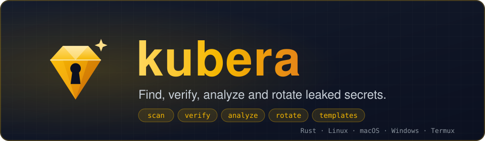
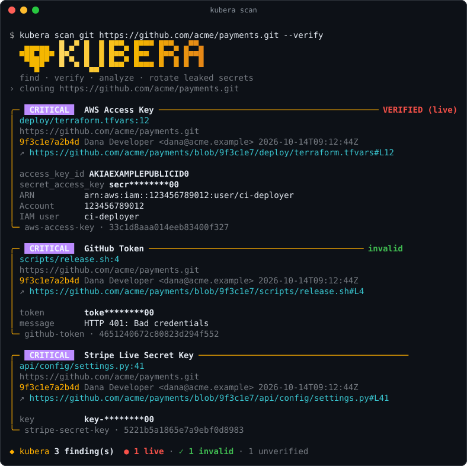
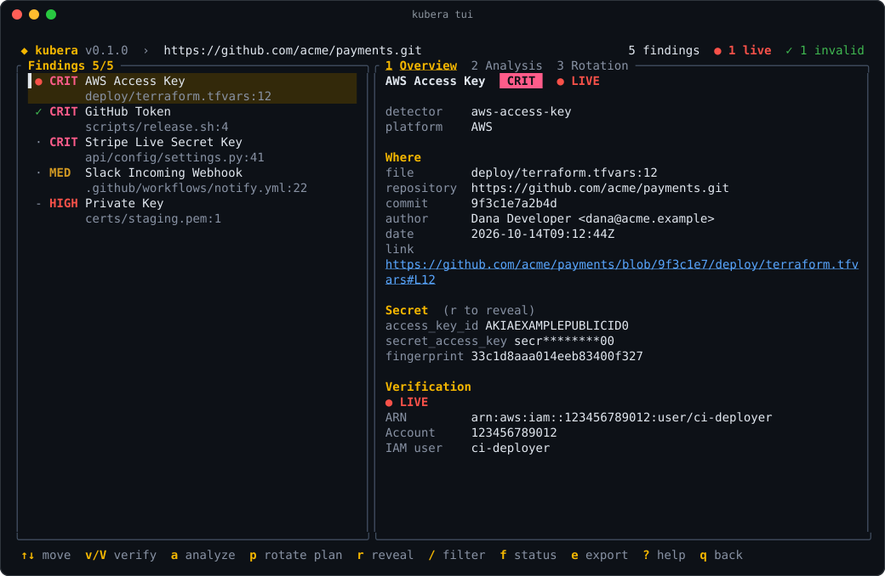

<div class="kubera-hero">
  
  <p class="kubera-lead">Kubera is a fast, template-driven secret scanner written in Rust. It finds leaked credentials, asks each platform which ones are <strong>live</strong>, shows what they can reach, and helps you <strong>rotate</strong> them.</p>
  <div class="kubera-actions">
    <a class="kubera-btn primary" href="installation.html">Install</a>
    <a class="kubera-btn" href="quickstart.html">Your first scan</a>
    <a class="kubera-btn" href="workflow.html">After a scan</a>
    <a class="kubera-btn" href="cheatsheet.html">Cheat sheet</a>
  </div>
</div>

## Try it

Install, then scan a repository, verify what it finds and browse the results:

```bash
curl -fsSL https://raw.githubusercontent.com/dmdhrumilmistry/kubera/main/install.sh | sh
kubera scan git https://github.com/acme/payments.git --verify -i
```

## Start here

<ol class="kubera-steps">
  <li><a href="installation.html"><strong>Install</strong><span>One script, <code>cargo install</code>, a release binary or the container image.</span></a></li>
  <li><a href="quickstart.html"><strong>First scan</strong><span>Scan a folder or a repository and read the findings.</span></a></li>
  <li><a href="quickstart.html#3-verify-which-secrets-are-live"><strong>Verify</strong><span>Ask each platform which secrets are live, invalid or unknown.</span></a></li>
  <li><a href="workflow.html"><strong>Triage and rotate</strong><span>Rotate live secrets, mark the rest, commit the baseline.</span></a></li>
</ol>

## What do you want to scan?

<div class="kubera-cards three">
  <a class="kubera-card" href="scanning.html"><strong>A repository</strong><p>Files and the full git history, including deleted secrets.</p><code>kubera scan git .</code></a>
  <a class="kubera-card" href="remote.html"><strong>A remote or private repo</strong><p>HTTPS, SSH or <code>github.com/org/repo</code>, with a token for private ones.</p><code>kubera scan git github.com/acme/payments</code></a>
  <a class="kubera-card" href="incremental.html"><strong>A whole organization</strong><p>GitHub, GitLab or Bitbucket, with cached mirrors and incremental re-scans.</p><code>kubera scan repos --github-org acme</code></a>
  <a class="kubera-card" href="containers.html"><strong>Container images</strong><p>Every layer plus ENV and build history. No Docker needed.</p><code>kubera scan image ghcr.io/acme/api:1.4.2</code></a>
  <a class="kubera-card" href="github.html"><strong>GitHub beyond code</strong><p>Issues, pull requests, review comments, Actions logs, wikis and gists.</p><code>kubera scan github --org acme</code></a>
  <a class="kubera-card" href="gitlab.html"><strong>GitLab and Bitbucket beyond code</strong><p>Issues, merge and pull requests, comments, CI and Pipelines logs, snippets.</p><code>kubera scan gitlab --group acme</code></a>
  <a class="kubera-card" href="slack.html"><strong>Slack, Jira and Confluence</strong><p>Channel messages and threads, tickets and their history, wiki pages and versions.</p><code>kubera scan slack --token-env SLACK_TOKEN</code></a>
  <a class="kubera-card" href="packages.html"><strong>Published packages</strong><p>What users install from npm, PyPI and crates.io, digest-verified.</p><code>kubera scan package npm:@acme/cli</code></a>
  <a class="kubera-card" href="huggingface.html"><strong>Hugging Face</strong><p>Models, datasets and Spaces: full git history, LFS files on request.</p><code>kubera scan huggingface acme</code></a>
  <a class="kubera-card" href="buckets.html"><strong>Buckets</strong><p>S3, S3-compatible stores, Google Cloud Storage and Azure Blob, archives opened.</p><code>kubera scan bucket s3://acme-backups</code></a>
  <a class="kubera-card" href="kubernetes.html"><strong>Kubernetes</strong><p>Secrets, ConfigMaps and workload env of a live cluster, read-only.</p><code>kubera scan k8s</code></a>
  <a class="kubera-card" href="ci.html"><strong>CI and pre-commit</strong><p>A GitHub Action, a container image and a hook that blocks leaking commits.</p><code>kubera hook install</code></a>
  <a class="kubera-card" href="writing-templates.html"><strong>Your own detectors</strong><p>Add a platform with one YAML file: regexes, verification, rotation.</p><code>kubera templates new acme-key</code></a>
</div>

## The whole lifecycle of a leaked secret

<div class="kubera-cards">
  <div class="kubera-card"><strong>Detect</strong><p>Files, full git history, whole orgs, container images, GitHub issues and Actions logs, S3/GCS buckets, live Kubernetes clusters and stdin. Finds secrets in deleted commits, inside archives and behind base64.</p></div>
  <div class="kubera-card"><strong>Verify</strong><p>Asks the issuing platform whether each secret is live, so you fix real leaks first.</p></div>
  <div class="kubera-card"><strong>Analyze</strong><p>Who owns the credential, its scopes, and what it can reach.</p></div>
  <div class="kubera-card"><strong>Rotate</strong><p>Dry-run plans, then vendor API calls to replace or revoke, with a manual runbook where there is no API.</p></div>
</div>

Every platform is described by a **YAML template**: its regexes, its verification endpoint, its analysis probes and its rotation steps. Supporting a new platform means writing one YAML file; nothing needs recompiling.



## Interactive

Run `kubera` with no arguments in a terminal for the TUI. You can scan a folder or a repository, browse findings, verify, analyze and plan rotations, all from the keyboard. See [Interactive TUI](tui.md), and [After a scan](workflow.md) for what to do with each finding.



## Design goals

- **Safe by default.** Secrets are redacted in output and verification is opt-in. Only HTTPS is allowed. Rotation is a dry run unless explicitly executed, and git runs hardened against hostile repositories. See [Security model](security.md).
- **Data, not code.** Detectors are declarative and statically validated. Each template carries its own positive and negative samples, so `kubera templates test` keeps them honest.
- **Fast.** A single Aho-Corasick pass decides which detectors run on each chunk. Files are scanned in parallel, git history runs one `git log` per CPU, and identical secrets are verified once.
- **Everywhere.** Linux, macOS, Windows and Android (Termux), with a layout that adapts to phone-sized terminals.
- **CI-native.** A GitHub Action, a container image, a pre-commit hook, baselines so CI only fails on new leaks, SARIF, HTML reports and Slack or webhook alerts.

Kubera borrows ideas from [TruffleHog](https://github.com/trufflesecurity/trufflehog), including keyword prefiltering, live verification and per-platform analyzers. The difference is that Kubera moves the per-platform logic out of compiled code and into templates.
