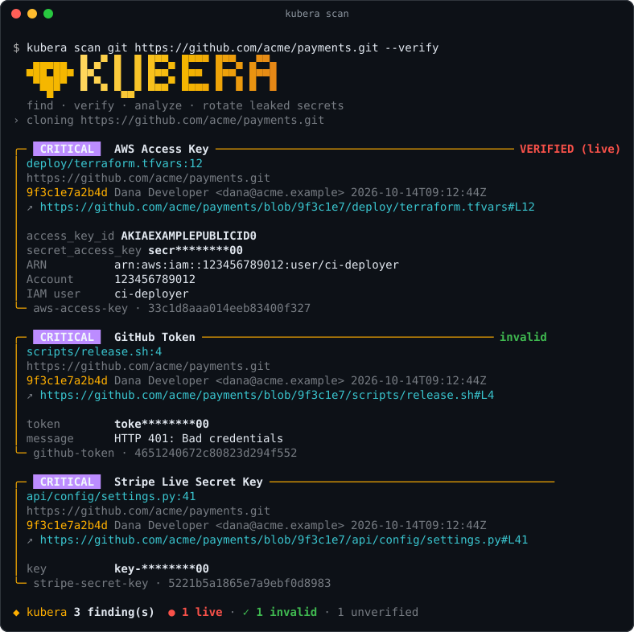
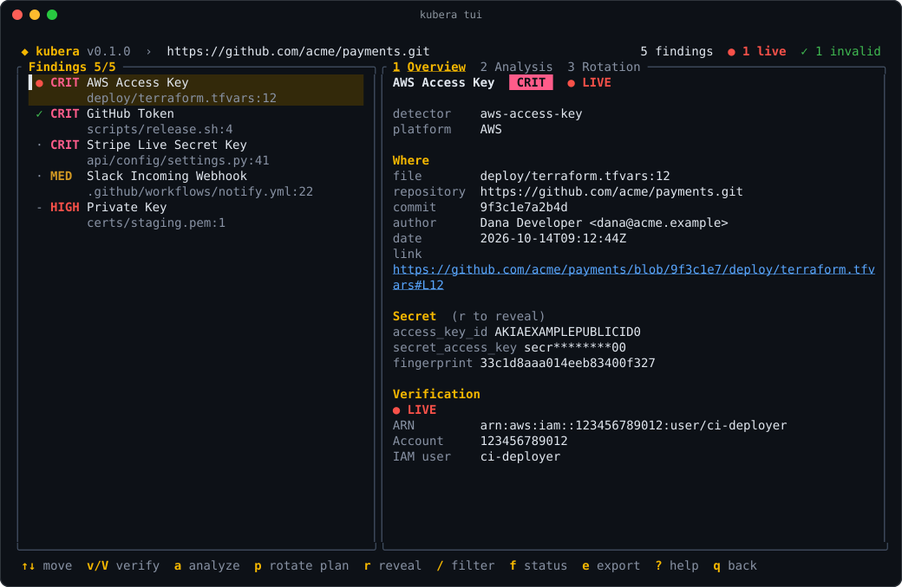

# Your first scan

This page takes you from a fresh install to a verified list of findings, and points you at what to do next. Install Kubera first, see [Installation](installation.md).

## 1. Scan a folder or a repository

```bash
kubera scan fs .                                       # the files in this folder
kubera scan git .                                      # this repository, full history
kubera scan git https://github.com/acme/payments.git   # a remote repository
```

`scan git` reads **every commit**, so it also finds secrets that were committed and deleted later. A plain scan is offline: nothing leaves your machine until you ask for verification.

## 2. Read the results



Each finding is a card with:

- the **severity** and the kind of secret (AWS Access Key, GitHub Token, ...),
- **where** it is: file and line, and for git history the commit, author, date and a link to the exact line,
- the **secret, redacted** (`--show-secrets` prints it in full, which you rarely want),
- the detector id and a **fingerprint**, which identifies this secret in baselines and allowlists.

## 3. Verify: which secrets are live?

```bash
kubera scan git . --verify
```

With `--verify`, Kubera asks each platform whether the credential works. Each secret goes only to the endpoint its own template names, over HTTPS, and identical secrets are checked once. Every finding then gets a status:

| Status | Meaning |
|---|---|
| <span class="kubera-status live">● live</span> | The platform accepted the credential. Rotate it now. |
| <span class="kubera-status invalid">✓ invalid</span> | The platform rejected it: revoked, expired or fake. |
| <span class="kubera-status unknown">? unknown</span> | No clear answer: network error, rate limit or an odd response. |
| <span class="kubera-status unverifiable">- not verifiable</span> | The detector has no verifier, for example private keys. |

To see only live secrets, use `--only-verified`.

## 4. Browse the findings in the TUI

Add `-i` to any scan to browse the results interactively, or run `kubera` with no arguments for the home menu:

```bash
kubera scan git https://github.com/acme/payments.git --verify -i
```



Move with <kbd>↑</kbd> <kbd>↓</kbd>, verify with <kbd>v</kbd> or <kbd>V</kbd>, and press <kbd>?</kbd> for every key. See [Interactive TUI](tui.md).

## 5. Next: act on what you found

<div class="kubera-cards">
  <a class="kubera-card" href="workflow.html"><strong>After a scan: triage and response</strong><p>Rotate live secrets, mark invalid ones, retry unknown results. Start here.</p></a>
  <a class="kubera-card" href="cheatsheet.html"><strong>Cheat sheet</strong><p>Copyable commands for reports, CI, the pre-commit hook and more.</p></a>
  <a class="kubera-card" href="hooks.html"><strong>Stop new leaks</strong><p>A pre-commit hook blocks commits that add secrets.</p></a>
  <a class="kubera-card" href="ci.html"><strong>Scan in CI</strong><p>The GitHub Action fails pull requests that add secrets.</p></a>
</div>
