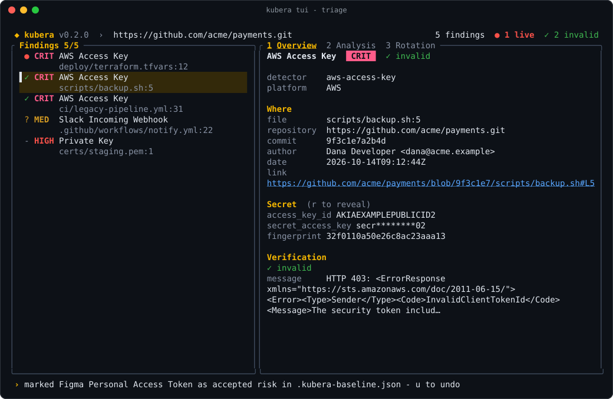

# Baselines and triage

Turning on a secret scanner in an old codebase usually finds things you already know about: test fixtures, revoked keys, documentation examples. A **baseline** records them once, so scans and CI only report **new** findings.

```bash
kubera scan git . --update-baseline    # record everything found today (exits 0)
git add .kubera-baseline.json && git commit -m "kubera baseline"
kubera scan git . --fail               # from now on, only new findings fail
```

## The baseline file

`.kubera-baseline.json` in the current directory is loaded automatically when it exists, by every scan, the [TUI](tui.md), the [MCP server](mcp.md) and the [pre-commit hook](hooks.md). Findings recorded in it are not reported.

| Flag | Meaning |
|---|---|
| `--baseline FILE` | Use another baseline file. |
| `--no-baseline` | Ignore the baseline and report everything. |
| `--update-baseline` | Add every finding of this scan to the baseline file, then exit 0. |

Each entry records a decision:

| Decision | Made by |
|---|---|
| `baseline` | `--update-baseline`: existing findings accepted when kubera was adopted |
| `false_positive` | <kbd>x</kbd> in the TUI: not a real secret |
| `accepted` | <kbd>m</kbd> in the TUI: a real secret, risk accepted (for example a sandbox key) |

```json
{
  "version": 1,
  "entries": [
    {
      "fingerprint": "bc0458ecc5e4611e9dde21f8",
      "detector": "github-token",
      "decision": "baseline",
      "path": "./secret.yaml",
      "line": 4,
      "added": "2026-11-09T18:03:06Z"
    }
  ]
}
```

- Entries match on the **fingerprint** (detector + secret). Path, line and commit are there for humans and are not used to match, so a decision follows the secret wherever it moves. The same secret pasted into a new file is not reported again either.
- The file contains **no secret values**, only fingerprints, which cannot be reversed. It is meant to be committed and reviewed like code.
- It is machine-managed. Kubera never rewrites your hand-written `.kubera.yaml`.
- To report a finding again, delete its entry from the file.

## Mark a false positive or accepted risk in the TUI

Browse findings with `kubera scan ... -i` (or `kubera`), then decide on each one:

| Key | Action |
|---|---|
| <kbd>x</kbd> | Mark the selected finding as a false positive |
| <kbd>m</kbd> | Mark it as an accepted risk |
| <kbd>u</kbd> | Undo the last mark |

A marked finding disappears from the list and is saved to `.kubera-baseline.json` straight away, so later scans and the CI job agree with your decision. Commit the file to share it.



Not sure which decision fits? [After a scan](workflow.md#invalid-secrets-mark-them-and-move-on) explains when to use each, by verification status.

## Baseline or allowlist?

Both hide findings. They differ in who writes them and what they match.

| | Baseline | Allowlist in `.kubera.yaml` |
|---|---|---|
| Written by | Kubera (`--update-baseline`, TUI) | You |
| Matches | Fingerprints | Fingerprints and secret regexes |
| Good for | Adopting kubera on an existing codebase, triage decisions | Patterns you never want reported (test keys, examples) |

Both are honoured everywhere. Remember that a baselined secret that is real is still a leak: rotate it, see [Verify, analyze and rotate](lifecycle.md).
