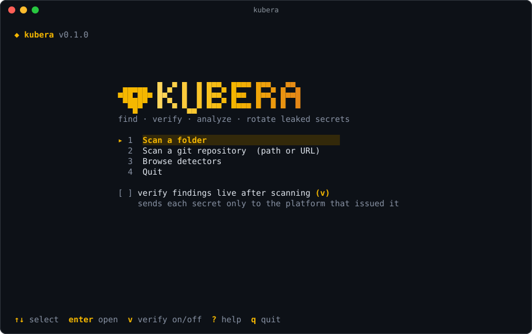
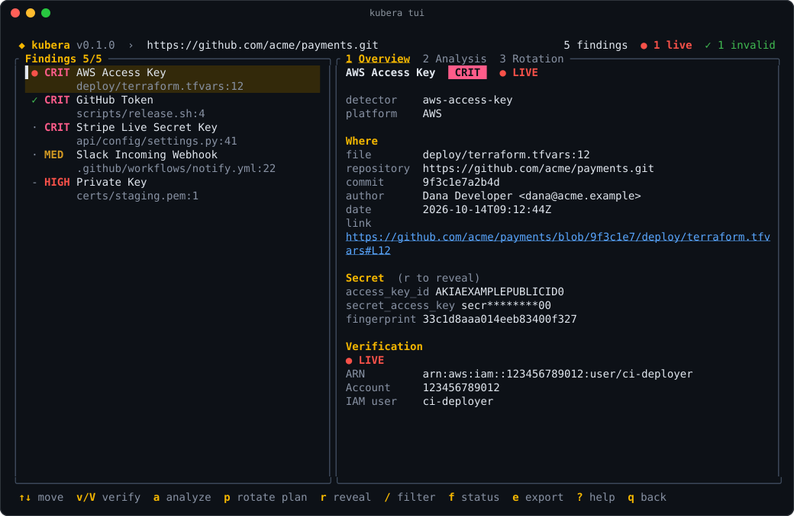
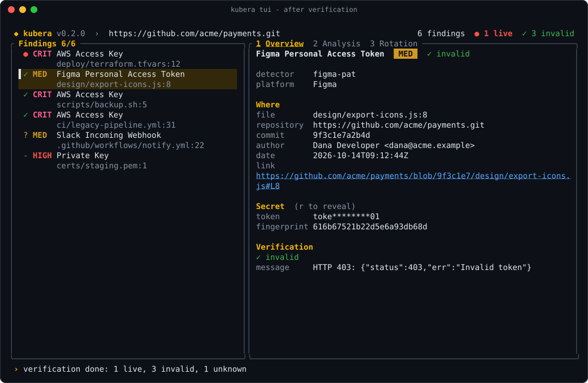
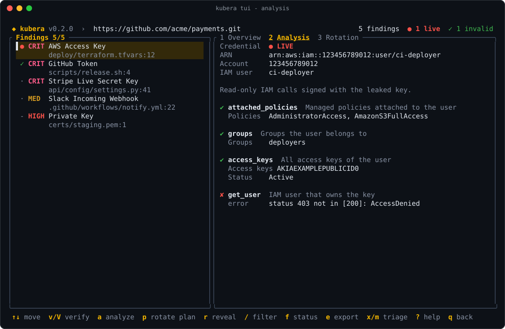
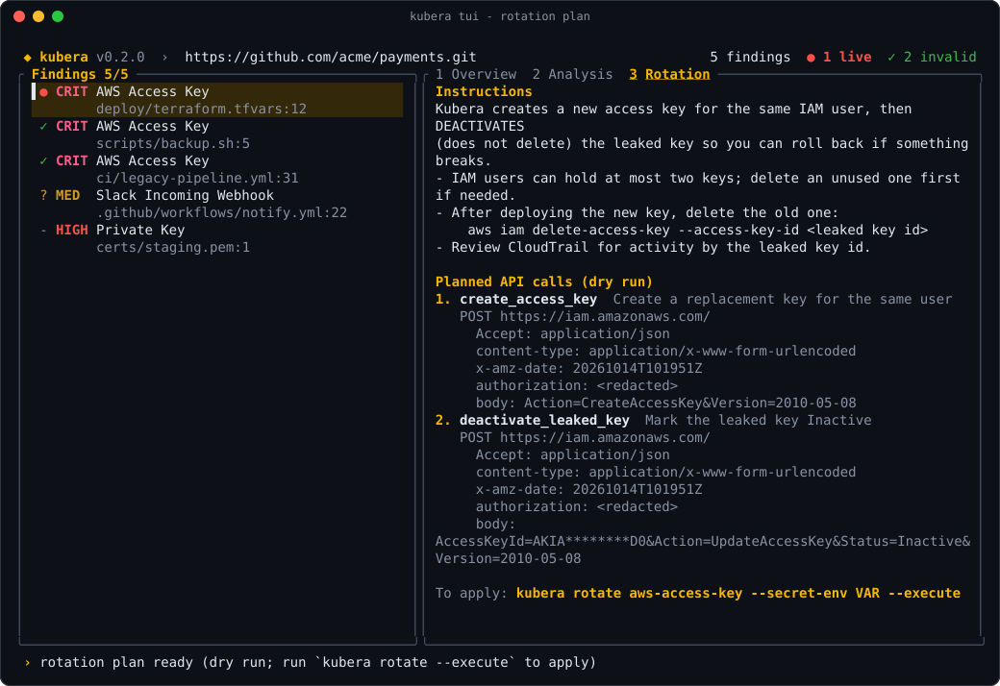
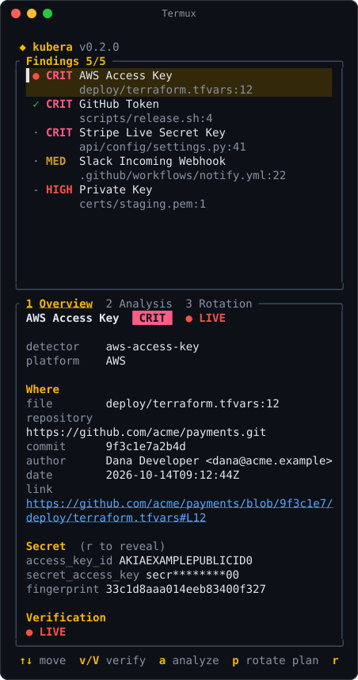

# Interactive TUI

The TUI lets you scan, browse findings, verify them, see what a live credential can reach and plan its rotation, all from the keyboard. Run `kubera` with no arguments in a terminal (or `kubera tui`) to open it:



```bash
kubera                                  # home menu
kubera tui ./services/api               # scan a folder straight away
kubera tui github.com/org/repo          # scan a repository (URLs are detected)
kubera tui . --git --verify             # this repo's history, verify when done
kubera scan git . --verify -i           # any CLI scan, results in the TUI
```

`-i` / `--interactive` works with every `scan` source and all its flags (including `--token-env` for private repositories).

<div class="kubera-callout tip">
<p class="kubera-callout-title">Scan done, now what?</p>

[After a scan: triage and response](workflow.md) walks through each status: rotate live secrets, mark invalid ones, retry unknown results.

</div>

## Browsing findings



The list shows each finding's verification status (`●` live, `✓` invalid, `?` unknown, `-` not verifiable, `·` not verified yet) and severity. The detail pane has three tabs:

| Tab | Shows |
|---|---|
| <kbd>1</kbd> **Overview** | Location, commit, author, link, the (redacted) secret, fingerprint and verification result |
| <kbd>2</kbd> **Analysis** | Identity, scopes and permission probes from read-only API calls |
| <kbd>3</kbd> **Rotation** | The rotation runbook and the dry-run API plan |

## Verifying findings

Press <kbd>V</kbd> to verify every finding that has not been verified yet, or <kbd>v</kbd> for the selected one (also to retry an `unknown` result). With the [verification cache](scanning.md#verification-cache) on (`kubera tui --verify-cache`, `scan ... -i --verify-cache` or `verify_cache:` in `.kubera.yaml`), <kbd>V</kbd> reuses recent results and marks them `cached` in the detail pane; <kbd>v</kbd> always asks the platform again. The header counts live and invalid findings, and the status line sums up the result when the last answer is in:



## Analysis and rotation plans

<kbd>a</kbd> runs read-only API calls with a live credential and shows who owns it and what it can reach:



<kbd>p</kbd> shows the rotation runbook and the API calls a rotation would make, as a dry run. Nothing is changed:



## Keyboard shortcuts

| Key | Action |
|---|---|
| <kbd>↑</kbd> <kbd>↓</kbd> / <kbd>j</kbd> <kbd>k</kbd> | Move |
| <kbd>g</kbd> / <kbd>G</kbd> | First / last finding |
| <kbd>v</kbd> | Verify the selected finding (on the home screen: toggle verify-after-scan) |
| <kbd>V</kbd> | Verify every unverified finding |
| <kbd>a</kbd> | Analyze the selected finding |
| <kbd>p</kbd> | Rotation plan (dry run) for the selected finding |
| <kbd>1</kbd> <kbd>2</kbd> <kbd>3</kbd> / <kbd>Tab</kbd> | Switch detail tab |
| <kbd>PgUp</kbd> / <kbd>PgDn</kbd> | Scroll the detail pane |
| <kbd>r</kbd> | Reveal / hide the secret |
| <kbd>/</kbd> | Filter by text (detector, name, path, commit) |
| <kbd>f</kbd> | Filter by status: all → live → not invalid → invalid |
| <kbd>e</kbd> | Export redacted findings to `kubera-findings-<time>.json` (mode `0600`) |
| <kbd>x</kbd> | Mark the selected finding as a false positive (saved to the baseline) |
| <kbd>m</kbd> | Mark it as an accepted risk (saved to the baseline) |
| <kbd>u</kbd> | Undo the last mark |
| <kbd>?</kbd> | Help |
| <kbd>q</kbd> / <kbd>Esc</kbd> | Back / quit |
| <kbd>Ctrl+C</kbd> | Quit |

Network work (verification, analysis, rotation plans) runs in the background, so the interface never freezes. A spinner marks findings that are being checked.

## Triage: false positives and accepted risks

<kbd>x</kbd> and <kbd>m</kbd> remove the finding from the list and record the decision in `.kubera-baseline.json` in the current directory, straight away. Findings already in that file are not shown, in this session or later ones, and CLI scans, the pre-commit hook and CI skip them too once you commit the file. <kbd>u</kbd> undoes the last mark. See [Baselines and triage](triage.md).

## Safe by design

- Secrets are masked until you press <kbd>r</kbd>, and hidden again as soon as you move to another finding.
- <kbd>e</kbd> always exports **redacted** findings, to a new file with mode `0600`.
- Rotation in the TUI is plan-only. Applying a rotation stays an explicit CLI step (`kubera rotate … --execute`), with its confirmation prompt.
- The TUI never lets SSH prompt (it owns the terminal). For private repositories, use `kubera scan git URL --token-env VAR -i`.

## Phones and small terminals

The layout adapts to the terminal size: below 100 columns the list and the details stack vertically, so it works in Termux on a phone.


