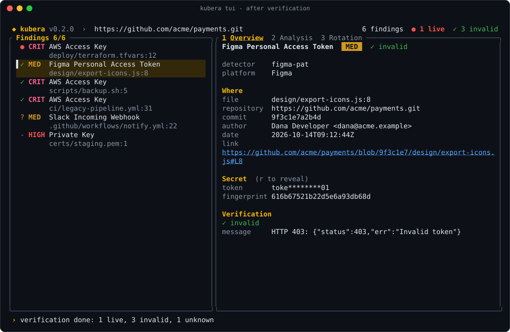
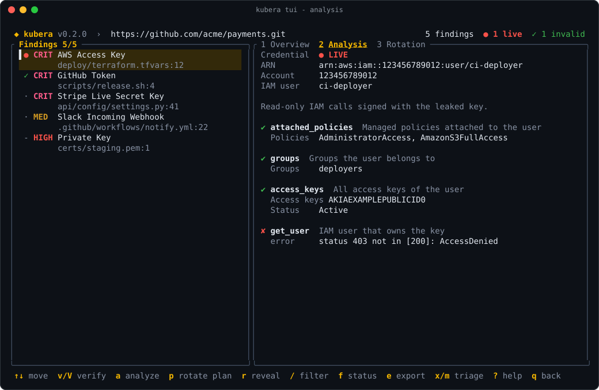
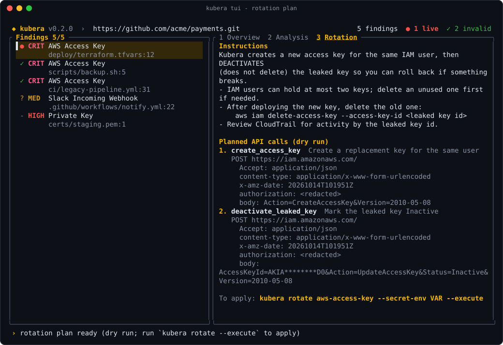
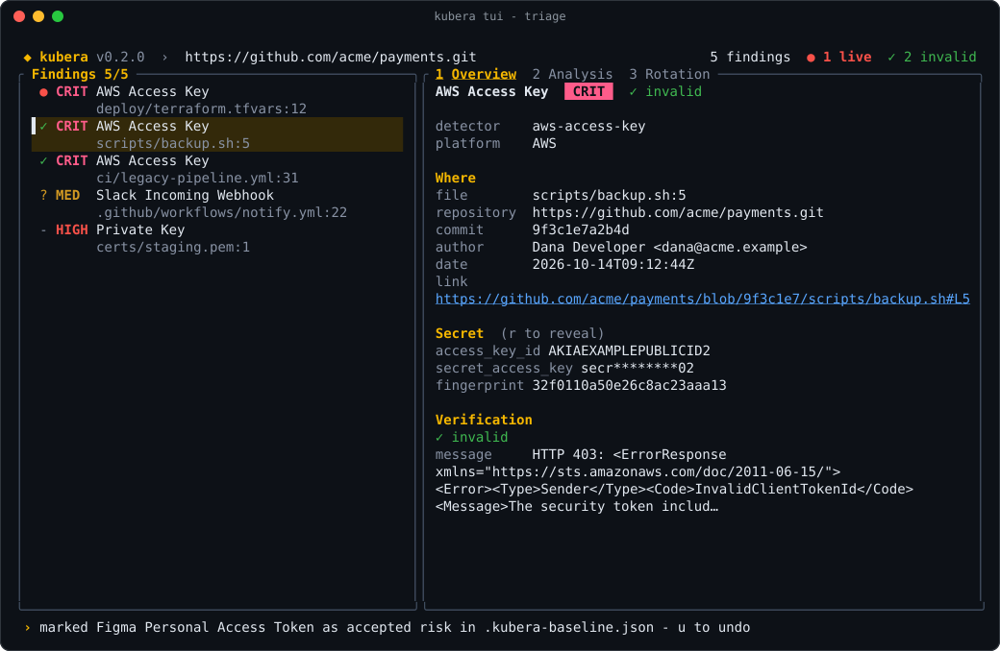

# After a scan: triage and response

A scan gives you a list of findings. This page tells you what to do next with each one, based on what its platform said when Kubera verified it: **live**, **invalid**, **unknown** or **unverifiable**.

<div class="kubera-callout tip">
<p class="kubera-callout-title">In short</p>

- <span class="kubera-status live">● live</span> The credential works. Rotate it now: [analyze, plan, rotate, re-verify](#live-secrets-revoke-and-rotate).
- <span class="kubera-status invalid">✓ invalid</span> The platform rejected it. Nothing to rotate. [Mark it](#invalid-secrets-mark-them-and-move-on) with <kbd>m</kbd> or <kbd>x</kbd> and commit `.kubera-baseline.json`.
- <span class="kubera-status unknown">? unknown</span> No clear answer. [Verify again](#unknown-results-verify-again) later, or check by hand.
- <span class="kubera-status unverifiable">- not verifiable</span> Kubera cannot check this type. [Review it by hand](#unverifiable-findings-review-by-hand).

</div>

## Step 1: verify the findings

A scan without `--verify` only finds candidates. Every finding then shows `·` (not verified yet). Ask the platforms which ones are live:

- In the TUI, press <kbd>V</kbd> to verify every finding, or <kbd>v</kbd> for the selected one.
- On the command line, add `--verify` to the scan:

```bash
kubera scan git https://github.com/acme/payments.git --verify -i
```

When verification finishes, the header counts live and invalid findings and the status line sums up the result:



The **Verification** section of the Overview tab (<kbd>1</kbd>) shows the platform's answer for the selected finding, including the HTTP status and message. Press <kbd>f</kbd> to show only live findings, then only findings that are not invalid, then only invalid ones.

## Step 2: decide by status

<div class="kubera-flow">
  <div class="kubera-flow-start">Scan verified. Read each finding's status.</div>
  <div class="kubera-flow-branches">
    <div class="kubera-flow-branch live">
      <div class="kubera-flow-head"><span class="kubera-status live">● live</span></div>
      <p class="kubera-flow-what">The platform accepted it. Treat it as an incident.</p>
      <ol>
        <li>Analyze: <kbd>a</kbd></li>
        <li>Rotation plan: <kbd>p</kbd></li>
        <li>Rotate on the CLI</li>
        <li>Update every consumer</li>
        <li>Verify again: <kbd>v</kbd> shows invalid</li>
        <li>Mark it, clean history if needed</li>
      </ol>
      <a class="kubera-flow-more" href="#live-secrets-revoke-and-rotate">Rotate a live secret</a>
    </div>
    <div class="kubera-flow-branch invalid">
      <div class="kubera-flow-head"><span class="kubera-status invalid">✓ invalid</span></div>
      <p class="kubera-flow-what">Revoked, expired or fake. No vendor action.</p>
      <ol>
        <li>Real but dead: <kbd>m</kbd> accepted risk</li>
        <li>Not a secret: <kbd>x</kbd> false positive</li>
        <li>Commit <code>.kubera-baseline.json</code></li>
        <li>Optional: rewrite history</li>
      </ol>
      <a class="kubera-flow-more" href="#invalid-secrets-mark-them-and-move-on">Triage invalid findings</a>
    </div>
    <div class="kubera-flow-branch unknown">
      <div class="kubera-flow-head"><span class="kubera-status unknown">? unknown</span></div>
      <p class="kubera-flow-what">Timeout, rate limit or an unexpected answer.</p>
      <ol>
        <li>Read the message</li>
        <li>Check network, proxy, TLS</li>
        <li>Verify again: <kbd>v</kbd></li>
        <li>Still unknown: check in the vendor console</li>
      </ol>
      <a class="kubera-flow-more" href="#unknown-results-verify-again">Retry unknown results</a>
    </div>
    <div class="kubera-flow-branch unverifiable">
      <div class="kubera-flow-head"><span class="kubera-status unverifiable">- not verifiable</span></div>
      <p class="kubera-flow-what">No verifier, for example private keys.</p>
      <ol>
        <li>Open the file and commit</li>
        <li>Real: replace it, <kbd>p</kbd> shows how</li>
        <li>Then <kbd>m</kbd> or <kbd>x</kbd></li>
      </ol>
      <a class="kubera-flow-more" href="#unverifiable-findings-review-by-hand">Review by hand</a>
    </div>
  </div>
</div>

| TUI | Status | Meaning | Do this |
|---|---|---|---|
| `●` live | `verified` | The platform accepted the credential. | Rotate it now. |
| `✓` invalid | `invalid` | The platform rejected it: revoked, expired or never real. | Mark it with <kbd>m</kbd> or <kbd>x</kbd>. |
| `?` unknown | `unknown` | Inconclusive: network error, rate limit or an unexpected response. | Verify again, or check by hand. |
| `-` not verifiable | `unverifiable` | The detector has no verifier (for example private keys). | Review by hand. |
| `·` | not verified | Verification has not run. | Press <kbd>v</kbd> or <kbd>V</kbd>. |

## Live secrets: revoke and rotate

A live credential works right now, for anyone who has read the repository, image or log where it leaked. Fix these first.

### 1. Analyze: what can it reach?

Select the finding and press <kbd>a</kbd> (tab <kbd>2</kbd>). Kubera makes **read-only** API calls with the credential and shows who owns it, its scopes and what it can access. A failed probe is useful too: it shows a permission the credential does not have.



Same on the command line: `kubera analyze <detector>`, see [analyze](lifecycle.md#analyze).

### 2. Plan the rotation (dry run)

Press <kbd>p</kbd> (tab <kbd>3</kbd>). Kubera shows the template's runbook and the exact API calls a rotation would make, with secrets redacted. **Nothing is changed**: plans are always dry runs.



### 3. Rotate on the command line

The TUI never rotates anything. Applying a rotation is an explicit CLI step. Run it without the secret and Kubera asks for each part at a prompt (secret parts are hidden), shows the plan and asks you to type the detector id to confirm:

```bash
kubera rotate aws-access-key --execute -o new-aws-key.json
```

Or pass the leaked value through environment variables. Multi-part secrets take one `-e part=VAR` per part, single-part secrets just the variable:

```bash
kubera rotate aws-access-key \
  -e access_key_id=LEAKED_KEY_ID \
  -e secret_access_key=LEAKED_SECRET \
  --execute -o new-aws-key.json

kubera rotate gitlab-pat --secret-env LEAKED_TOKEN --execute -o new-gitlab-token.json
```

To get the leaked value, open the finding's link, or press <kbd>r</kbd> in the TUI to reveal it (it is hidden again as soon as you move).

<div class="kubera-callout danger">
<p class="kubera-callout-title">--execute makes real changes</p>

- Kubera verifies the credential again and **refuses** unless it is live (`--force` overrides this).
- It shows the plan and asks you to type the detector id. `--yes` skips the prompt: use it only in scripts you have tested.
- The new credential is written **once**, to a new file with mode `0600` (`-o` never overwrites a file). Move it into your secret manager, then delete the file. Never commit it.

</div>

Many platforms have no rotation API (Stripe, OpenAI, Figma, ...). For those, `kubera rotate <detector>` prints the manual steps: do them in the vendor's console. The [rotation support table](lifecycle.md#rotation-support) lists what is automated.

### 4. Update every consumer

Put the new credential wherever the old one was used: the secret manager, CI secrets, deployment environment, other services. Kubera can do the common ones as part of the rotation: `--store` writes the new credential to a GitHub Actions secret, Vault or AWS Secrets Manager once the rotation succeeds, without printing it:

```bash
kubera rotate gitlab-pat --secret-env LEAKED_TOKEN --execute \
  --store github:acme/payments:GITLAB_TOKEN --store-token-env GH_ADMIN_TOKEN
```

See [Secret stores after rotation](secret-stores.md). Redeploy, and check that things still work. Some rotations keep the old credential around for a rollback: AWS, for example, **deactivates** the leaked key instead of deleting it. Delete it once the new key is deployed, as the plan's instructions say.

### 5. Verify again

Select the finding and press <kbd>v</kbd>. It should now show `✓ invalid`. On the command line, `kubera verify` exits with `2` when the credential is invalid:

```bash
kubera verify aws-access-key -e access_key_id=LEAKED_KEY_ID -e secret_access_key=LEAKED_SECRET
echo $?   # 2 = invalid, 0 = still live, 3 = unknown
```

Then check the vendor's audit log (CloudTrail for AWS, the audit log for GitHub, ...) for activity by the leaked credential since the commit date shown in the Overview tab.

### 6. Clean up

- Track the follow-up: `kubera remediate --issues github:<owner>/<repo>` opens one issue per live secret in a private repository, with the locations and this checklist, and never a duplicate. See [Remediation](remediation.md).
- Remove the secret from the current code. Read it from the environment or a secret manager instead.
- The old value is still in git history, so later scans keep reporting it, now as invalid. Follow the [invalid branch](#invalid-secrets-mark-them-and-move-on): mark it, and rewrite history only if you need to.

## Invalid secrets: mark them and move on

An invalid finding is a credential the platform **rejected**: it was revoked, it expired, or it was never real. Anyone who finds it cannot use it, so there is nothing to rotate or revoke. Analysis and rotation need a live credential, so <kbd>a</kbd> shows "Analysis runs only for live credentials" and `kubera rotate --execute` refuses.

Record a decision so the finding stops coming back:

| Key | Decision | Use it when |
|---|---|---|
| <kbd>m</kbd> | accepted risk | It was a real credential, it is dead now, and you accept that it stays in history. |
| <kbd>x</kbd> | false positive | It is not a secret: a test fixture, an example, a placeholder. |
| <kbd>u</kbd> | undo | You marked the wrong finding. |

The finding leaves the list straight away and the decision is saved to `.kubera-baseline.json`:



To record every invalid finding at once, use the CLI. `--results invalid` keeps only invalid findings and `--update-baseline` records them (with the decision `baseline`):

```bash
cd payments    # your checkout of the repository, so the file lands there
kubera scan git . --verify --results invalid --update-baseline
```

Then commit the file, see [Make decisions stick](#make-decisions-stick-the-baseline-file).

### Optional: remove the secret from git history

Once a credential is invalid, the copy in history is harmless. Rewriting history is only worth it when policy requires it, or when you cannot be sure every copy is dead.

<div class="kubera-callout warning">
<p class="kubera-callout-title">Rewriting history is disruptive</p>

It changes every commit hash after the leak and needs a force push. Agree on a time with everyone who works on the repository: they must re-clone or hard-reset afterwards, and open pull requests need rebasing. Forks, existing clones and caches keep the old commits. **Rotate first**: a rewrite never un-leaks a live secret.

</div>

Kubera prepares the rewrite for [git filter-repo](https://github.com/newren/git-filter-repo). `kubera purge` takes the findings file, finds the raw values in the repository's history (a redacted file is fine), writes a `--replace-text` expressions file (mode `0600`, outside the repository) and prints the exact commands. It never rewrites or pushes anything itself:

```bash
kubera scan git . -f json > findings.json
kubera purge --findings findings.json --repo .
```

Then run the printed commands: a fresh bare clone (every branch and tag), `git filter-repo`, a scan to check, and the force push. Delete the expressions file afterwards, it holds the raw secrets. On GitHub, pull request refs and cached views may still show the old commits until GitHub Support removes them. Details in [Remediation](remediation.md#prepare-a-history-rewrite).

## Unknown results: verify again

Unknown means Kubera got no clear answer: a timeout, a network error, a rate limit (HTTP 429) or a response the template does not expect. The `message` line in the Verification section says which.

1. Read the message. A timeout or connection error points at the network, an HTTP 429 at rate limiting.
2. Check the network: egress rules and proxies must allow the vendor's API host, and a TLS-intercepting proxy needs its CA in the system trust store (on Termux, see [TLS roots](installation.md#termux-android)). Raise the timeout with `--timeout <secs>` if needed.
3. Select the finding and press <kbd>v</kbd> to verify it again. <kbd>V</kbd> only verifies findings that were never verified, so use <kbd>v</kbd> to retry.
4. Or verify it on its own, pasting the value at the hidden prompt. Exit code `3` means still unknown:

   ```bash
   kubera verify slack-webhook
   ```

5. Still unknown? Check the credential in the vendor's console. Until you know, **treat it as live**.

## Unverifiable findings: review by hand

Some detectors have no verifier, for example private keys. Kubera cannot ask anyone whether they still work.

1. Open the file and commit from the Overview tab. Is it a real key, and what trusts it?
2. If it is real, replace it. Press <kbd>p</kbd> (or run `kubera rotate private-key`) for the runbook: generate a new key pair, install the new public key or certificate, then remove the old one and revoke its certificate.
3. Mark it: <kbd>m</kbd> once replaced, or <kbd>x</kbd> if it is a test key or an example.

## Track progress over time

Add `--db` to your scans (or `db: true` to `.kubera.yaml`) and every scan is recorded, redacted, in a local findings database. `kubera serve` then shows a dashboard on `http://127.0.0.1:8484/`: open and live findings, trends, which repositories and detectors leak most, and when each secret was first and last seen. See [Findings dashboard](dashboard.md).

```bash
kubera scan git . --verify --db
kubera serve
```

## Make decisions stick: the baseline file

Triage decisions live in `.kubera-baseline.json`, in the directory you started Kubera from. Every later scan, the TUI, the [pre-commit hook](hooks.md) and [CI](ci.md) load it from the working directory and skip the findings recorded in it.

```bash
git add .kubera-baseline.json
git commit -m "kubera: record triage decisions"
```

- The file holds **fingerprints only**, never secret values, so it is safe to commit and review like code.
- A fingerprint is the detector plus the secret, so a decision follows the secret into other files and commits.
- To report a finding again, delete its entry from the file.
- Scanning a remote repository? Start Kubera from your checkout of it, so the file lands in the repository.

More in [Baselines and triage](triage.md).

## Keyboard cheat sheet

| Key | Action |
|---|---|
| <kbd>↑</kbd> <kbd>↓</kbd> or <kbd>j</kbd> <kbd>k</kbd> | Move |
| <kbd>g</kbd> / <kbd>G</kbd> | First / last finding |
| <kbd>1</kbd> <kbd>2</kbd> <kbd>3</kbd> or <kbd>Tab</kbd> | Overview / Analysis / Rotation tab |
| <kbd>PgUp</kbd> <kbd>PgDn</kbd> | Scroll the detail pane |
| <kbd>V</kbd> / <kbd>v</kbd> | Verify all unverified / the selected finding |
| <kbd>a</kbd> | Analyze (read-only API calls) |
| <kbd>p</kbd> | Rotation plan (dry run) |
| <kbd>r</kbd> | Reveal the secret (hidden again when you move) |
| <kbd>/</kbd> | Filter by text |
| <kbd>f</kbd> | Filter by status: all, live, not invalid, invalid |
| <kbd>m</kbd> / <kbd>x</kbd> / <kbd>u</kbd> | Accepted risk / false positive / undo |
| <kbd>e</kbd> | Export redacted JSON (mode `0600`) |
| <kbd>?</kbd> | Help |
| <kbd>q</kbd> / <kbd>Esc</kbd> | Back |

## Command-line equivalents

| In the TUI | On the command line |
|---|---|
| Scan, then <kbd>V</kbd> | `kubera scan git <repo> --verify` |
| <kbd>f</kbd> live only | `kubera scan git <repo> --only-verified` |
| <kbd>v</kbd> on one finding | `kubera verify <detector>` |
| <kbd>a</kbd> | `kubera analyze <detector>` |
| <kbd>p</kbd> | `kubera rotate <detector>` (dry run) |
| Not in the TUI | `kubera rotate <detector> --execute -o new.json` |
| Not in the TUI | `kubera rotate <detector> --execute --store github:<owner>/<repo>:<NAME>` |
| Mark every finding at once | `kubera scan git . --update-baseline` (decision `baseline`) |
| <kbd>e</kbd> | `kubera scan git <repo> --verify -f json > findings.json` |
| Not in the TUI | `kubera remediate --findings findings.json --issues github:<owner>/<repo>` |
| Not in the TUI | `kubera purge --findings findings.json --repo .` |

`verify`, `analyze` and `rotate` ask for the secret at a hidden prompt, or take `-e part=VAR` / `--secret-stdin`. See [Verify, analyze and rotate](lifecycle.md).

## Example: every finding is invalid

You scan a repository and get five findings: a Figma token and four AWS keys. After verification the status line says `verification done: 0 live, 5 invalid, 0 unknown`. What now?

1. **Nothing is exposed right now.** All five credentials are dead, so there is nothing to rotate or revoke.
2. **Optionally check the past.** If a key was live once, the vendor's audit log shows whether it was used while it sat in the repository. The commit date in the Overview tab tells you since when.
3. **Mark them.** In the TUI, press <kbd>m</kbd> on each real-but-dead credential and <kbd>x</kbd> on anything that is not a real secret. Or record all of them at once from your checkout:

   ```bash
   kubera scan git . --verify --results invalid --update-baseline
   ```

4. **Commit `.kubera-baseline.json`.** Later scans, the pre-commit hook and CI stop reporting these five.
5. **Clean up the code.** Remove any of them still in the current files. Rewrite history only if you need to (see [above](#optional-remove-the-secret-from-git-history)).
